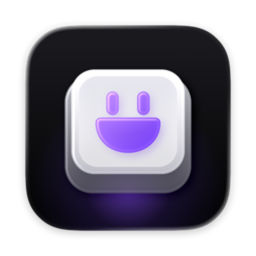
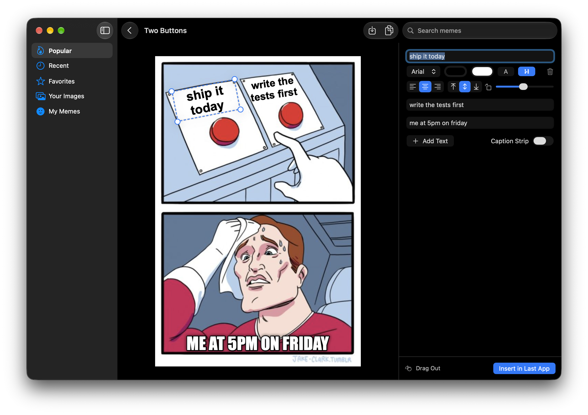
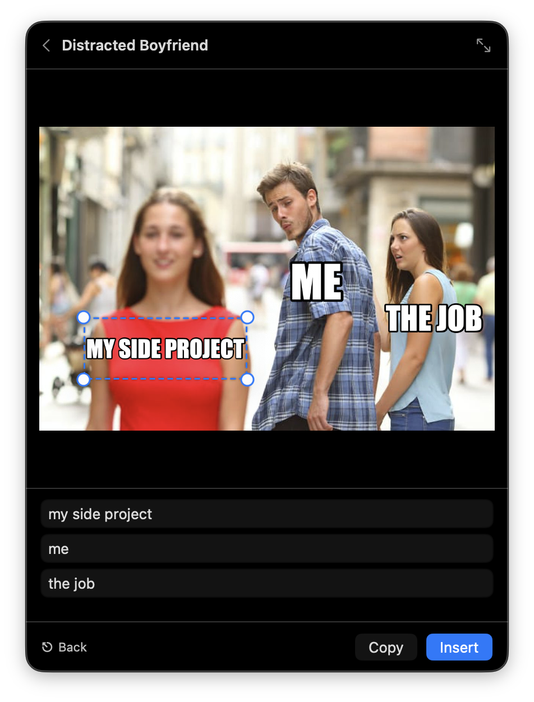

<p align="center">
  
</p>

# Hypermeme

An app for finding, captioning and pasting memes without leaving what you're doing. Imgflip as a native app: SwiftUI on macOS, and GTK on [Omarchy](https://omarchy.org) and other Hyprland setups.



## What it does

- **Lives in the menu bar.** Press ⌃⌥M anywhere, or click the grin at the top right of the screen. The panel opens over whatever you're doing without taking focus from it. The shortcut can be changed in Settings.
- **Finds any template.** Search covers imgflip's whole catalog, by name or by the other names people use, like "drakeposting". Popular templates scroll on for as long as you keep going.
- **Finds new memes too.** Templates imgflip doesn't have yet come from [hypermeme-templates](https://github.com/alexisbcz/hypermeme-templates), described so search finds them by what they show and mean: "coffee riot" finds the woman drinking espresso during a Paris riot.
- **Captions video memes.** Some of those templates are clips, marked with ▶ and their length. Caption one like any meme: the text is drawn on every frame, and it's inserted as an MP4, which chat apps attach when it's pasted. "terry davis video" finds the TempleOS ones.
- **Puts the text in the right place.** Each template opens with imgflip's own layout: text boxes in position, rotated where needed, with the right font and colors.
- **Inserts it where you were typing.** Type a caption and press Return. The meme is pasted into the app you were using, as an image. If nothing there can take it, Hypermeme asks you to click the box you want and pastes it there. Without Accessibility access, Insert copies it and you press ⌘V yourself.
- **Keeps what you make.** My Memes holds every finished meme as a PNG. Search them by caption, insert one again, download it, drag it into another app, or edit it again.
- **Edits properly when you want to.** The main window has draggable, resizable and rotatable text, six fonts, text and outline colors, alignment, a soft shadow, and a white caption strip above the image.
- **Captions your own images.** Drop one on the window, or press ⇧⌘V to use the clipboard.
- **Runs on your Mac.** Text is drawn locally with no watermark, no account and no imgflip login. An internet connection is needed only for searching and for templates you haven't opened before.

<p align="center">
  
</p>

## Keyboard

In the panel:

| Key | Action |
| --- | --- |
| Type | Search |
| Arrow keys | Move through the grid |
| ⇥ | Next section |
| ↩ | Open a template, or insert a finished meme |
| ↩ in a caption | Insert |
| ⇧⌘C | Copy without pasting |
| ⎋ | Go back, then close |

Right-click the menu bar icon for the main window, Settings, updates and Quit.

## Links

`hypermeme://` links work from scripts, launchers and Shortcuts:

```sh
open 'hypermeme://panel?q=drake'
open 'hypermeme://search?q=boat cat'
open 'hypermeme://edit?template=two%20buttons&text=ship%20it&text=write%20tests&panel=1'
```

## Installation

### Download

Get `Hypermeme-<version>.dmg` from the [latest release](https://github.com/alexisbcz/hypermeme/releases/latest), open it, and drag Hypermeme into Applications. It needs macOS 26 or later.

The app isn't notarized, so macOS blocks the first launch. Allow it under **System Settings › Privacy & Security › Open Anyway**, or run:

```sh
xattr -dr com.apple.quarantine /Applications/Hypermeme.app
```

To paste directly, allow Hypermeme under **System Settings › Privacy & Security › Accessibility**. It uses that access only to press ⌘V after you choose Insert. The build is ad-hoc signed, so macOS may ask again after an update.

### Build from source

```sh
curl -fsSL https://raw.githubusercontent.com/alexisbcz/hypermeme/main/install.sh | bash
```

This builds Hypermeme with Xcode and installs it in Applications. For development, `make run` builds and starts it, and `make test` runs the tests.

## On Omarchy

Hypermeme runs on [Omarchy](https://omarchy.org), and on any Arch system with Hyprland. Install it with the same command as on a Mac:

```sh
curl -fsSL https://raw.githubusercontent.com/alexisbcz/hypermeme/main/install.sh | bash
```

Then press **Super+Ctrl+M** anywhere. The panel opens over what you're doing, like Omarchy's own menus. Search, pick a template, type the captions and press Return: the meme is pasted into the window you were in, the way Omarchy's universal paste (Super+V) sends Ctrl+V. Click beside the panel or press Escape to close it. In a terminal, Ctrl+V reaches the program inside, so the meme pastes into tools that take images, like Claude Code.

It works the way the Mac app does: imgflip's whole catalog and layouts, My Memes, favorites, your own images (drop one on the window, or press Ctrl+Shift+V), and a main window with the full editor. The differences:

- **It follows your Omarchy theme.** Colors come from the current theme's `colors.toml`, and Hypermeme restyles itself when you switch themes.
- **Fonts are open look-alikes.** Impact, Comic Sans and Marker Felt aren't on Linux, so Anton, Comic Neue and Permanent Marker ship with Hypermeme. Arial, Helvetica and Georgia use Liberation and Noto.
- **Copy uses wl-clipboard,** and the shortcut lives in Hyprland, not in Settings.
- **The panel is a layer-shell overlay.** It keeps no window of its own, so it never lands on a workspace.

The installer:

- installs what's missing with pacman (python-gobject, gtk4, libadwaita, gtk4-layer-shell, wl-clipboard)
- puts Hypermeme in `~/.local/lib/hypermeme`, with the `hypermeme` command in `~/.local/bin`
- adds a launcher entry, and registers `hypermeme://` links
- adds the shortcut to `~/.config/hypr/bindings.lua` and a login item to `autostart.lua`, between `>>> hypermeme >>>` markers, backing both files up first
- reloads Hyprland and checks it accepted the change

Pass options after `bash -s --`: `--key "SUPER + ALT + M"` picks another shortcut, `--no-bind` and `--no-autostart` leave Hyprland alone, and `--uninstall` removes Hypermeme and its lines again. Your memes stay in `~/.local/share/hypermeme`.

From the command line:

```sh
hypermeme toggle                  # open or close the panel
hypermeme panel drake             # open the panel, searching
hypermeme edit "two buttons" "ship it" "write tests" --panel
xdg-open 'hypermeme://search?q=boat cat'
```

For development, `make -C linux run` starts it from the checkout, and `make -C linux test` runs the tests.

## Releasing

1. Set `MARKETING_VERSION` in `project.yml` to the new version, so builds from source know which release they match.
2. Tag it and push the tag:

   ```sh
   git tag v0.2.0 && git push origin v0.2.0
   ```

The Release workflow builds the DMG, signs it for Sparkle, and publishes it with an `appcast.xml`, which installed copies read from the latest release. Signing needs the `SPARKLE_PRIVATE_KEY` repository secret, the private half of the `SUPublicEDKey` in `Hypermeme/Info.plist`. Sparkle's `generate_keys --account hypermeme` (in `build/SourcePackages/artifacts/sparkle/Sparkle/bin` after a build) keeps it in your keychain; `generate_keys --account hypermeme -x key.txt` exports it. Keep a backup: without it, installed copies can't take updates.

`make dmg` builds the same DMG locally.

Meme templates belong to their owners and come from [imgflip](https://imgflip.com). Hypermeme isn't affiliated with imgflip.

[MIT License](LICENSE)
